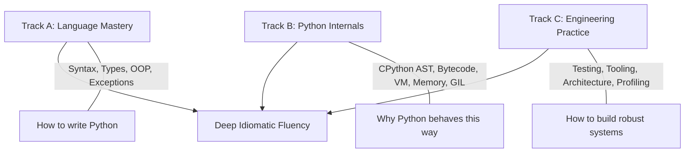

# Learning Method & Pedagogical Framework

The **Python Mastery Lab** is engineered to transform passive reading into active, internal-level software engineering mastery.

---

## 1. The Three Parallel Tracks

Mastery is not achieved linearly through syntax alone. Learning proceeds across three interconnected tracks:

1. **Track A — Language Mastery**: Syntax, typing, data structures, control flow, functions, OOP, exceptions, iterators, and modules.
2. **Track B — Python Internals**: Names and object references, memory layout, CPython evaluation loop, AST, bytecode compilation, frames, garbage collection, and runtime behavior.
3. **Track C — Engineering Practice**: Automated testing (`pytest`), linters (`ruff`), static typing (`mypy`), profiling, debugging, security, packaging, and production architecture.

---

## 2. Standard 24-Point Lesson Structure

For each major topic, lessons adhere to a structured, reproducible framework:

1. **Learning Objectives**: Clear, verifiable capabilities you will gain.
2. **Prerequisites**: Concepts that must be mastered before starting this topic.
3. **Definition**: Unambiguous, formal technical definition.
4. **Why This Concept Exists**: The design problem and historical pain point it solves.
5. **Mental Model**: High-level visual or conceptual model.
6. **Syntax and Rules**: Exact grammar, formal constraints, and keyword semantics.
7. **Basic Example**: The cleanest, minimal example isolating the mechanism.
8. **Step-by-Step Execution**: Detailed trace of evaluation order, memory state, and stack frames.
9. **Internal Mechanics**: CPython implementation (C structures, bytecode opcodes, object flags).
10. **Intermediate Examples**: Practical patterns encountered in real-world codebases.
11. **Advanced Examples**: Intricate configurations, metaprogramming, or edge integrations.
12. **Edge Cases**: Surprising boundary conditions and non-obvious behaviors.
13. **Common Mistakes**: Real bugs made by engineers in production.
14. **Common Misconceptions**: Myths vs. reality (e.g., "variables are boxes").
15. **Comparison with Related Concepts**: Distinguishing similar constructs (e.g., `is` vs `==`, `tuple` vs `list`).
16. **Practical Applications**: Where and why this is utilized in industry.
17. **Performance Considerations**: Algorithmic complexity ($O$), memory footprint, interpreter overhead.
18. **Security Considerations**: Injection hazards, serialization traps, denial-of-service risks.
19. **Experiments**: Executable scripts designed to test hypotheses and observe runtime behavior.
20. **Exercises**: Multi-stage problem sets (Predict-the-output, Find-the-bug, Write-from-scratch).
21. **Interview & Viva Questions**: Rigorous conceptual, architectural, and edge-case questions.
22. **Answers & Explanations**: Thorough, non-trivial breakdowns of every exercise and question.
23. **Revision Summary**: High-density flash sheet of critical principles.
24. **Mastery Checklist**: Concrete verification criteria before marking as `MASTERED`.

---

## 3. The 5 Levels of Progression

| Level | Designation | Competency Milestone |
| :--- | :--- | :--- |
| **Level 1** | **Foundation** | Syntax, basic types, expressions, control flow, functions, basic collections. |
| **Level 2** | **Strong Programmer** | Scope (LEGB), mutability, argument binding, OOP, iterators, generators, exceptions, imports, files, standard library. |
| **Level 3** | **Advanced Python** | Decorators, descriptors, static typing, context managers, packaging, introspection, metaprogramming. |
| **Level 4** | **Runtime & Systems** | CPython VM, bytecode, memory internals, concurrency (threads/processes/asyncio), GIL/free-threading, performance profiling, security. |
| **Level 5** | **Professional Mastery** | End-to-end architectures, production services, rigorous test suites, code reviews, benchmarking, system diagnostics. |

---

## 4. Mastery State Taxonomy

Progress on any topic or project is tracked strictly using 5 explicit states:

- `NOT STARTED`: Topic has not been opened.
- `LEARNING`: Lesson reviewed, core definitions understood.
- `PRACTICED`: Associated `.py` experiments run and exercises attempted.
- `ASSESSED`: Viva questions, output prediction, and debugging drills answered correctly.
- `MASTERED`: Concept can be explained from memory, defended under viva interrogation, and applied correctly in unfamiliar code without looking at notes.
