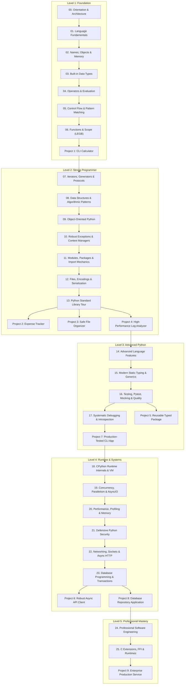

# Master Learning Roadmap

This roadmap defines the end-to-end learning progression through the **Python Mastery Lab**. Each module has explicit dependencies, learning tracks, and verification criteria.

---

## 1. Visual Curriculum Architecture

---

## 2. Module Index & Descriptions

| Module | Title | Track | Focus & Deliverable |
| :--- | :--- | :--- | :--- |
| **00** | **Orientation** | Foundations & Internals | Computing model, CPython vs specification, compilation pipeline, environment. |
| **01** | **Language Fundamentals** | Language | Lexing, indentation tokens (`INDENT`/`DEDENT`), literals, expressions vs statements. |
| **02** | **Names, Objects & Memory** | Internals | Name binding, `PyObject`, identity vs equality, mutability, reference counts, aliasing. |
| **03** | **Data Types** | Language & Internals | All 16 primitive and collection types, hashability rules, memory representations. |
| **04** | **Operators & Evaluation** | Language | Short-circuiting, operator precedence, augmented assignments, operator dunders. |
| **05** | **Control Flow** | Language | Conditional branching, `match/case` structural patterns, loop `else`, comprehensions. |
| **06** | **Functions** | Language & Internals | First-class functions, parameter types (`*`, `/`), closures, LEGB scope, frame objects. |
| **07** | **Iterators & Generators** | Language | Iterator protocol (`__iter__`, `__next__`), generators, `yield from`, lazy pipelines. |
| **08** | **Data Structures & Algorithms** | Engineering | Big-O, sequence performance, hash collision handling, stack/queue patterns. |
| **09** | **Object-Oriented Programming** | Language & Internals | Class construction, MRO (C3 Linearization), descriptors, metaclasses, dataclasses. |
| **10** | **Exceptions** | Language & Engineering | Exception hierarchy, chaining (`from`), context managers (`__enter__`/`__exit__`). |
| **11** | **Modules & Imports** | Internals | `sys.modules`, `sys.meta_path`, import mechanics, circular import resolution. |
| **12** | **Files & Data Formats** | Engineering | UTF-8 encodings, buffered I/O, `pathlib`, JSON, CSV, pickle security. |
| **13** | **Standard Library** | Engineering | Essential modules (`collections`, `itertools`, `functools`, `re`, `subprocess`, etc.). |
| **14** | **Advanced Language Features** | Language | Deep unpacking, assignment expressions, pattern guards, structural typing. |
| **15** | **Typing** | Engineering | `typing` module, generics, `TypeVar`, `Protocol`, `ParamSpec`, static verification. |
| **16** | **Testing & Quality** | Engineering | `unittest`, `pytest`, fixtures, parameterization, mocks, coverage, property testing. |
| **17** | **Debugging** | Engineering | Traceback dissection, `pdb`/`breakpoint()`, logging architectures, reproducible MREs. |
| **18** | **CPython Runtime Internals** | Internals | Bytecode disassembly (`dis`), evaluation loop, adaptive specialization, object headers. |
| **19** | **Concurrency & Parallelism** | Systems | Multithreading, Multiprocessing, GIL, AsyncIO event loop, free-threaded Python. |
| **20** | **Performance & Optimization** | Systems | `cProfile`, `timeit`, `tracemalloc`, algorithmic optimization, memory tuning. |
| **21** | **Defensive Security** | Systems | Code injection, path traversal, safe subprocess invocation, secrets management. |
| **22** | **Networking & APIs** | Systems | HTTP protocol, socket programming, resilient connection pools, async clients. |
| **23** | **Database Programming** | Systems | DB-API 2.0, parameterized SQL, ACID transactions, connection lifecycles, repositories. |
| **24** | **Professional Engineering** | Engineering | PEP 8, design patterns, dependency injection, 12-factor apps, CI/CD, documentation. |
| **25** | **C Extensions & Alternatives** | Systems | Pybind11 / C API basics, PyPy, Rust extensions (Maturin/PyO3), runtime selection. |

---

## 3. Project Roadmap

1. **Project 1: CLI Calculator** (`28_projects/01_cli_calculator`)
   - *Key Skills*: AST expression evaluation / token parsing, custom exceptions, comprehensive input validation, unit tests.
2. **Project 2: Expense Tracker** (`28_projects/02_expense_tracker`)
   - *Key Skills*: Modular design, data normalization, JSON/CSV persistence, transactional file updates.
3. **Project 3: Safe File Organizer** (`28_projects/03_file_organizer`)
   - *Key Skills*: `pathlib`, safe file operations, collision resolution, dry-run mode, detailed logging.
4. **Project 4: High-Performance Log Analyzer** (`28_projects/04_log_analyzer`)
   - *Key Skills*: Lazy generator pipelines, regular expressions, streaming memory efficiency, aggregated metrics.
5. **Project 5: Reusable Python Package** (`28_projects/05_package_development`)
   - *Key Skills*: Standard `pyproject.toml`, explicit exports (`__all__`), strict type annotations, 100% test coverage.
6. **Project 6: Asynchronous API Client** (`28_projects/06_async_api_client`)
   - *Key Skills*: `asyncio`, connection pooling, exponential backoff retries, rate-limiting, cancellation handling.
7. **Project 7: Tested CLI Application** (`28_projects/07_tested_cli_application`)
   - *Key Skills*: `argparse` / `click`, dependency injection, mock-tested external services, structured logging.
8. **Project 8: Database Application** (`28_projects/08_database_application`)
   - *Key Skills*: Repository pattern, parameterized queries, SQLite migration management, unit-of-work transactions.
9. **Project 9: Production-Style Python Service** (`28_projects/09_production_style_python_service`)
   - *Key Skills*: Full enterprise service: configuration management, structured logging, health checks, metrics, security hardening, full test suite.
